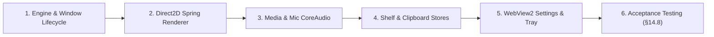

# Nuvra v1 Core — Architecture & Implementation Specification
**Document ID:** SPEC-2026-11-23-V1-CORE  
**Status:** DRAFT (Under Review)  
**Author:** Nuvra Core Engineering Team  
**Governing Standard:** `nuvra-master-prompt.md` Section 14  
**Date:** 2026-11-23  

---

## 1. Executive Summary & Scope

Nuvra v1 delivers the core Windows 10/11 notch bar experience, operating strictly within the zero-telemetry, memory-safe, sub-millisecond latency performance envelope defined in Section 8 of the Master Specification.

### In Scope for v1:
1. **Notch Engine & Window Lifecycle (§14.1):**
   - Win32 borderless, topmost, layered window with DirectComposition visual target.
   - Dynamic hit-testing (`WM_NCHITTEST`) allowing click-through when Idle and interactive target acquisition when Ambient/Glance/Expanded.
   - 4-state spring-physics animated layout: `Idle` (0 px / hidden pill), `Ambient` (compact 32 px pill), `Glance` (peek 48 px), `Expanded` (full card 180–320 px).
   - Multi-monitor handling (`WM_DPICHANGED`, `WM_DISPLAYCHANGE`), fullscreen auto-hide (`D-WIN-07`).
   - Context Engine executing the Section 5.5 priority resolution table.
2. **Media Module (§14.2):**
   - WinRT `GlobalSystemMediaTransportControlsSessionManager` event subscription.
   - Media controls (Play/Pause, Next, Prev, Scrub, System Volume via `IAudioEndpointVolume`).
   - WASAPI Loopback 32-band FFT visualizer via `rustfft` (Expanded mode only, display rate).
   - LRCLIB offline-first cached lyrics synchronization.
3. **Mic & Call Module (§14.3):**
   - Global microphone mute toggle via `IAudioEndpointVolume::SetMute` (`Ctrl+Alt+M`).
   - Audio session capture monitor (`IAudioSessionManager2`) and webcam registry monitor (`CapabilityAccessManager\ConsentStore\webcam`).
   - Active call detection across configurable conference targets (Teams, Zoom, Meet, Discord, Webex, Slack).
4. **Notifications Module (§14.4):**
   - WinRT `UserNotificationListener` toast capture with permission onboarding flow.
   - Focus Assist / Do Not Disturb compliance.
   - Ephemeral display queue (content never logged or persisted to disk per R-20).
5. **Files Shelf Module (§14.5):**
   - OLE `IDropTarget` and `DoDragDrop` drag-hover expansion with `CF_HDROP`.
   - File reference list, shell icon caching, quick zip compression, Explorer reveal.
6. **Clipboard Module (§14.6):**
   - `AddClipboardFormatListener` capture of text, URLs, and image descriptors.
   - Exclusion denylist (password managers, `ClipboardViewerIgnore`).
   - In-memory fuzzy search index (`nucleo`) and AES-256-GCM encrypted persistence via SQLite.
7. **Basics & Settings (§14.7):**
   - WebView2 settings window (vanilla TS/CSS bundled with esbuild, destroyed on close).
   - System tray icon (`Shell_NotifyIconW`), startup task registration, single-instance mutex.
   - Complete Fluent English localization (`locales/en-US/main.ftl`).

---

## 2. Component Architecture & Threading Model

```mermaid
flowchart TD
    subgraph UI_Thread["UI & Render Thread (Win32 Message Pump)"]
        HWND["Notch Window HWND (WS_EX_LAYERED)"]
        DComp["DirectComposition Target"]
        D2D["Direct2D & DirectWrite Context"]
        InputHandler["Hit-Test & Mouse/Touch Controller"]
        SpringSim["Spring Dynamics (60-144 Hz)"]
    end

    subgraph Core_Runtime["Supervisor & Context Engine"]
        ContextEngine["Context Arbiter (§5.5 Table)"]
        ConfigMgr["Config Manager (%APPDATA%)"]
        EventBus["Bounded Flume Event Channel"]
        Supervisor["Module Worker Supervisor (catch_unwind)"]
    end

    subgraph Module_Workers["Dedicated Module Threads"]
        MediaMod["nuvra-mod-media (GSMTC & WASAPI)"]
        MicMod["nuvra-mod-mic (CoreAudio & Registry)"]
        NotifMod["nuvra-mod-notifications (WinRT Listener)"]
        ShelfMod["nuvra-mod-shelf (IDropTarget & OLE)"]
        ClipMod["nuvra-mod-clipboard (Encrypted SQLite)"]
    end

    subgraph Auxiliary["Out-of-Process / On-Demand"]
        SettingsUI["WebView2 Settings Window (D-STK-04)"]
    end

    InputHandler -->|Window Messages| Core_Runtime
    Module_Workers -->|ModuleEvent| EventBus
    EventBus --> ContextEngine
    ContextEngine -->|Atomic State Snapshot| SpringSim
    SpringSim --> D2D
    D2D --> DComp
    DComp --> HWND
    Supervisor -->|Health Check & Restart| Module_Workers
    SettingsUI <-->|Local IPC (JSON)| Core_Runtime
```

### Thread Safety & Invariant Guarantees (R-13, R-14)
1. **Render Path Never Blocks:** The UI thread never locks on database mutexes, file I/O, or network calls. State communication is performed via `arc-swap::ArcSwap` atomic snapshots.
2. **Panic Isolation:** Every module worker thread runs inside `std::panic::catch_unwind`. A panic in any module (e.g., media session crash) is intercepted by the supervisor, logged (without content), and restarted with exponential backoff (100ms → 2s).
3. **Unsafe Isolation:** All Win32 COM, DXGI, DirectComposition, and OLE API calls are isolated in `nuvra-platform-win` with explicit `// SAFETY:` proofs. All other crates compile under `#![forbid(unsafe_code)]`.

---

## 3. Notch Engine State Machine & Spring Dynamics

The Notch transitions between 4 states governed by the spring parameters locked in Section 6.4:

| State | Target Height | Target Width | Corner Radius | Trigger Condition |
| :--- | :--- | :--- | :--- | :--- |
| **Idle** | 0 px (or 4 px gap bar) | 120 px | 6 px | No active media/call/notif, mouse outside notch |
| **Ambient** | 32 px | 180–220 px | 16 px | Background media playing, or mic active, mouse outside |
| **Glance** | 48 px | 260–300 px | 20 px | Mouse hover on Ambient, or keyboard focus (`Alt+N`) |
| **Expanded** | 180–320 px | 360–420 px | 24 px | Click/Tap on Glance, or Shelf drop, or Clipboard view |

### Spring Solver Integration
- **Formulation:** Semi-implicit Euler integration of damped harmonic oscillator:
  $$F = -k(x - x_0) - c v$$
- **Convergence Guard:** Once $|x - x_0| < 0.2\text{ px}$ and $|v| < 0.1\text{ px/s}$, the solver snaps to target and pauses rendering to preserve 0% idle CPU usage (D-PERF-01).

---

## 4. Context Engine Priority Matrix (§5.5)

The Context Engine continuously selects the active module rendered in the Notch:

1. **Priority 1 (Emergency/Active Feedback):** Mic mute toggle banner (1.5 s countdown).
2. **Priority 2 (Incoming Communication):** Active phone call / PC meeting in progress.
3. **Priority 3 (Ephemeral Alerts):** Notification banner toast (display timeout 5 s).
4. **Priority 4 (Interactive Overlays):** Drag-hover File Shelf, or Clipboard Manager invocation.
5. **Priority 5 (Background Media):** Currently playing audio/video via GSMTC.
6. **Priority 6 (Default Idle):** Compact clock/status or hidden sliver.

---

## 5. Storage & Privacy Architecture (R-19, R-20)

1. **Zero Telemetry:** No analytical SDKs, tracking pixels, or phone-home requests.
2. **Encrypted SQLite (`nuvra-core-shared::db`):**
   - Master database at `%LOCALAPPDATA%\Nuvra\data.db`.
   - SQLite tables encrypted with AES-256-GCM using a key derived from Windows DPAPI (`nuvra-platform-win::dpapi`).
   - Plaintext memory is zeroized via `zeroize::Zeroize` on buffer release.
3. **Clipboard Exclusions:**
   - Any window class matching `1Password`, `Bitwarden`, `KeePass`, or window carrying `ClipboardViewerIgnore` is bypassed without recording.

---

## 6. Implementation Stages & Verification Gates



### Verification Criteria:
- Unit and integration tests running under `cargo nextest run --workspace`.
- Zero compiler warnings, zero clippy warnings (`clippy --workspace --all-targets -- -D warnings`).
- Render frame time $\le 4\text{ ms}$ p95 on Floor test hardware.
- High contrast forced-colors mode verified with Windows Narrator screen reader.

---
